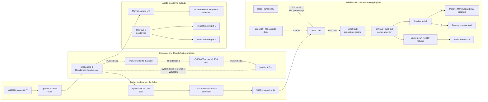

# ApolloBot - UAD Console Alt Monitor Automation

## Project Overview
ApolloBot automates alternate monitoring for my Universal Audio Apollo 8. The secondary speaker system is reached through the WiiM Ultra over S/PDIF, rather than through the Apollo's analog ALT 1 outputs. Because Console does not provide the routing this setup needs, ApolloBot syncs the front-panel ALT state with the Apollo's S/PDIF output: it sends the monitor mix for the digital alternate system and sends silent Cue 1 for the main-monitor state.

Cue 1 is reserved as the silent source for the digital alternate-monitor path. The Apollo's analog ALT 1 outputs are not connected. Both Apollo headphone outputs are assigned to C2 (Cue 2) and carry the monitor mix.

Also note that the commands don't always line up perfectly...there may be a split second where both monitors are playing at the same time, or a split-second of silence when you click the alt button.  Again, for me, this is within acceptable bounds for my use case.

## Hardware Setup

The setup has two audio hubs: the **UAD Apollo 8**, connected to the MacBook Pro over Thunderbolt, and the **WiiM Ultra**, which connects the turntable and cassette deck to a separate analog amplifier and speaker system. The Apollo and WiiM also exchange digital audio over S/PDIF.



### Signal paths

| Path | Connection and purpose |
| --- | --- |
| Computer to interface | The Apollo 8's Thunderbolt 2 option card connects through a Thunderbolt 2-to-3 adapter to the CalDigit TS3 dock, which connects to the MacBook Pro over Thunderbolt 3. System audio is sent to Console's Virtual 1/2 tracks. |
| Turntable to speakers | The Rega Planar 3 RS connects to the WiiM's Phono input; the WiiM provides the MM phono preamp stage. Its Line Out feeds the Schiit SYS, used as a pre-volume control, then the DIY EL84 push-pull power amp and the speaker switch. Switch position A connects the passive MartinLogan LX16 speakers. |
| Cassette to speakers | The Denon DR-M2 connects to a WiiM Line input and follows the same WiiM Line Out → Schiit SYS → power amp path. |
| Apollo to WiiM | Apollo S/PDIF coax output passes through a coax-to-optical converter into the WiiM's optical input. This brings Apollo audio into the WiiM and the separate amplifier system. |
| WiiM to Apollo | The WiiM's coax output connects to the Apollo's S/PDIF input. |
| Apollo main monitors | Apollo Monitor Out L/R connect to the powered Focal Shape 65 monitors. Both Apollo headphone outputs use C2 (Cue 2) with the monitor mix. |
| Headphone listening from the power amp | A divide-down resistor network feeds the headphone input from the power amp output. With the speakers disconnected, switch position B connects the dummy resistive load so the amplifier still has a load. |

### Digital alternate-monitor behavior

The Apollo's front-panel **ALT** button is the control for switching the digital WiiM/amp system. ApolloBot follows the ALT state and changes the Apollo's S/PDIF output source: ALT selects the monitor mix, while the main-monitor state selects Cue 1, which is configured to carry silence. This makes Cue 1 the silent state for the digital alternate path. The Apollo's analog ALT 1 outputs remain unused; the actual alternate speakers are driven by the WiiM and the separate power amp.

## Software Setup
- **macOS**: 15.6.1 (Sequoia)
- **UAD Console**: 1.2.6

I have no way of testing on windows.  If you'd like to help me out here and test that and help me modify things to work, I'd appreciate the help!

## Original Manual Workflow
To switch to alt monitors:
1. Mute the main output in UAD Console
2. Open cue output window
3. Set cue 1 to "mirror to s/pdif"
4. Click the mix button to send mix to S/PDIF

To switch back to main monitors:
1. Unselect the mix button in cue window
2. Unmute the main monitor

## Implementation Method
**TCP Protocol Automation**: This uses a reverse-engineered version of UAD Console's internal TCP communication protocol on Console's standard port (port 4710) to directly send commands.  These commands are reflected within the Console UI and on the Apollo's hardware.

**Credit**: This implementation was made possible by the groundbreaking work of [Radu Varga's UA-Midi-Control](https://github.com/raduvarga/UA-Midi-Control) project, which first reverse-engineered UAD's TCP messaging protocol using Wireshark. Thank you to Radu for open-sourcing this research and making UAD automation accessible to the community!

It was also entirely vibe coded using claude code.

## Technology Stack
- **Language**: Python 3 (standard library only...I specifically tested with 3.12.8)
- **Protocol**: Raw TCP sockets to UAD Console
- **Deployment**: Single executable file with global CLI access

### TCP Messages Used
ApolloBot communicates with UAD Console via TCP on port 4710 using these key messages:

**Monitor Control:**
- `get /devices/0/AltMonSelection` - Read hardware Alt button state
- `set /devices/0/AltMonSelection/value {0|1}` - Set Alt button state (0=main, 1=alt)

**S/PDIF Routing:**
- `get /devices/0/outputs/18/MixInSource` - Read S/PDIF output source
- `set /devices/0/outputs/18/MixInSource/value "mon"` - Route main mix to S/PDIF
- `set /devices/0/outputs/18/MixInSource/value "cue"` - Route cue 1 to S/PDIF (muted)

All messages are NULL-terminated and responses are JSON-formatted.

### How It Works
1. **Alt Monitor ON**: Sets S/PDIF output to route main monitor mix → tube amp gets main mix
2. **Alt Monitor OFF**: Sets S/PDIF output to route cue 1 mix (muted) → analog monitors active
3. **Auto-sync**: Background daemon watches for manual Alt button presses and syncs routing

### Installation

**Option 1: Run directly (no installation required)**
```bash
python3 apollobot.py status
python3 apollobot.py toggle
python3 apollobot.py start
```
etc.

**Option 2: Make globally accessible**
```bash
# Create ~/bin and add to PATH
mkdir -p ~/bin
ln -sf "$(pwd)/apollobot.py" ~/bin/apollobot
echo 'export PATH="$HOME/bin:$PATH"' >> ~/.zshrc

# Reload shell or open new terminal, then use:
apollobot status
apollobot toggle  
apollobot start
```
etc.

### Start automatically at computer startup (macOS)

The LaunchDaemon starts ApolloBot during system startup, under the account that installs it. It runs in the foreground so launchd can supervise it. If UAD Console is not listening on port 4710 yet, ApolloBot waits and retries every 15 seconds.

From the repository directory, run the installer as your normal account (it will ask for administrator authorization when installing the system job):

```bash
python3 install_launchd.py
```

If you started the watcher manually, stop it first with `python3 apollobot.py stop`.

The installer reads your account, home directory, current checkout path, and active Python executable, then generates and installs the LaunchDaemon plist. This lets the repository work from another username or checkout location without editing a plist by hand. Use `python3 install_launchd.py --dry-run` to inspect the generated plist without installing it.

To update or reinstall the job, run the installer again. It unloads an existing copy before replacing it. Check its state with `apollobot status`.

After installation, `apollobot start --launchd` loads the installed plist if the service is not currently loaded, starts it if it is loaded but stopped, and reports its PID if it is already running. It does not force-restart a live watcher, and it works while UAD Console is still starting.

The LaunchDaemon writes output to `~/.apollobot-launchd.log` and errors to `~/.apollobot-launchd-error.log`. Run `apollobot stop --launchd` to stop and unload it for the current boot; its plist remains installed so it will start automatically at the next system startup. To remove automatic startup, stop it and delete `/Library/LaunchDaemons/com.apollobot.watcher.plist`.

### Usage

Here are all the commands that are implemented:

```bash
apollobot alt      # Switch to alt monitors
apollobot main     # Switch to main monitors  
apollobot toggle   # Toggle between setups
apollobot status   # Show current state
apollobot start    # Start background watcher daemon
apollobot start --launchd  # Start the installed macOS LaunchDaemon
apollobot run      # Run in foreground and retry until UAD Console is available
apollobot stop     # Stop background watcher
apollobot stop --launchd  # Stop the installed macOS LaunchDaemon
apollobot log      # Show daemon activity
```

You can also use `apollobot --help` to see these commands within the terminal

### UAD Console diagnostic scripts

The repository also includes exploratory scripts for inspecting UAD Console's TCP interface. Run them from the repository directory while UAD Console is open:

```bash
python3 analyze_outputs.py
python3 discover_cue_mirror.py
python3 examine_all_outputs.py
```

- `analyze_outputs.py` inspects known output IDs, their properties, and possible mirror settings.
- `discover_cue_mirror.py` probes cue and mirror-related command paths. Before running it, set cue 1 to “mirror to S/PDIF” in Console; it will prompt before starting.
- `examine_all_outputs.py` scans output IDs 0–49 and reports properties that may relate to routing or mirroring.

These scripts print diagnostic results to the terminal and do not change Console settings.
